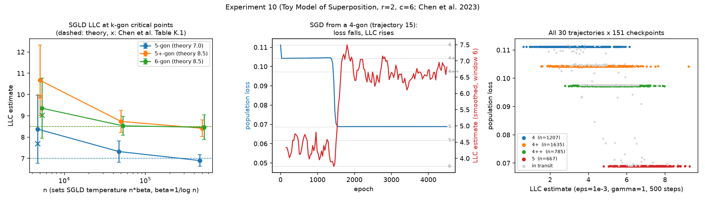
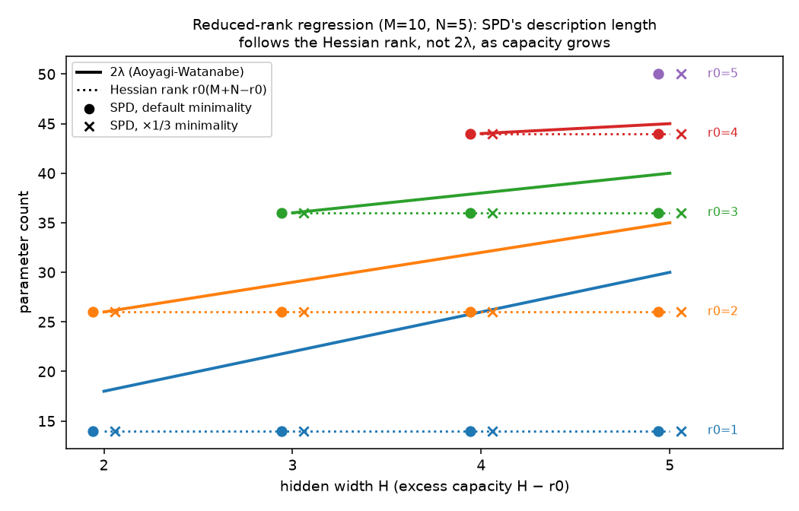

# arc-llc

How well can the local learning coefficient of a singular model be read off cheaply, and
what does the arc-space (contact-locus) picture of singularities say about the answer?

Estimators of the RLCT / local learning coefficient (LLC) λ, tested on singular models
where λ is known in closed form:

1. **Hessian null space** (geometric): codimension of the zero-curvature directions of the
   loss at a point on the singular set.
2. **SGLD** (devinterp-style): localized tempered-posterior sampling at β = 1/log n.
3. **Volume scaling**: Vol{K ≤ ε} ~ ε^λ |log ε|^{m−1}, fit with the log-multiplicity term.
4. **Dead-Direction Signatures** (Shirodkar & Narayanan, arXiv:2606.21158): closed-form
   spectral reads of activations and the per-sample Fisher-Gram.

Testbeds: rank-1 matrix factorization (λ = min(n,m)/2), the Aoyagi-Watanabe
reduced-rank-regression grid, an L-layer deep-linear bridge, and the **Toy Model of
Superposition**, where we reproduce the k-gon critical points, LLCs, and phase
transitions of Chen et al. (arXiv:2310.06301).

The geometric estimators are motivated by Mustață's jet-scheme characterization of log
canonical thresholds (arXiv:math/0102201): the RLCT is determined by dimensions of contact
loci in arc space, and the Hessian null space is the first-order contact data.
[`arc/`](arc/) pursues that picture directly (see below).

See [`RESULTS.md`](RESULTS.md) for the full write-up of the estimator experiments,
[`param_decomp_compare/`](param_decomp_compare/) for a pre-registered comparison of the LLC
with parameter decomposition, and [`arc/README.md`](arc/README.md) for the arc-space
results.

## Highlights

- **Ground truth recovered** on matrix factorization: the Hessian estimator exactly,
  volume scaling within 2-8%, and SGLD within 5-9% on the singular cases.
  A multi-restart min-codim fix makes the Hessian estimator exact on asymmetric branches,
  where a single read is up to 4× off (experiments 1-6).
- **Toy Model of Superposition** (experiment 10). Exact closed-form population loss.
  - k-gon losses and prior terms match the paper to 5 digits.
  - SGLD LLC estimates converge to the theoretical 7 / 8.5 / 8.5 as n grows (6.90, 8.41,
    8.46 at n = 5·10⁵), showing the overshoot in the paper's own Table K.1 is a finite-n
    effect.
  - The 5→6 Bayesian transition comes out at n_cr = 601 (paper: 601).
  - SGD runs from a 4-gon spend 95% of checkpoints on k-gon plateaus, with λ̂ rising as
    loss falls.
- **DDS** (experiments 7-9). The rate claim holds exactly (ρ = 1.000). Across the 14-cell
  RRR grid, read from a calibrated SGLD posterior ensemble whose own LLC tracks the closed
  form at ρ = 0.999, DDS orders cells by truth rank within a fixed width (17-20/20 pairs)
  but does not read λ's magnitude across widths. The apparent σ_min success (ρ = 0.86) is
  a layer-rank artifact.



## Arc spaces: what the Hessian misses, and λ by counting arcs

[`arc/README.md`](arc/README.md) has the details and status of each claim.

- **Reduced-rank regression, exactly.** Counting arcs by their Smith normal form
  reproduces the full Aoyagi–Watanabe formula, including its odd/even case split, which
  becomes integer minimization of a quadratic.
- **What the Hessian misses is tangent excess, not higher-order contact.** On RRR, λ is
  half the codimension of the largest component of the true set. All components meet at
  the minimum-norm solution, which is where ridge-regularized training, DDS and VPD read
  the model. There the Hessian rank falls short of 2λ by (H − r0)(N − r0). At generic
  true points it doesn't: the minimum Hessian rank over unregularized restarts recovers
  2λ on all 14 cells.
- **Deep linear networks.** A direct arc-space proof that rlct = codim/2 at depth 3 (outer
  Smith forms plus a totally unimodular linear program). Previously this followed only by
  comparing Pepin Lehalleur–Rimányi's codimension with Aoyagi's formula. Depth ≥ 4 is
  open.
- **Real vs complex.** The complex threshold that arc-space theorems compute can be
  strictly below λ. Symmetric factorization WWᵀ is a natural example, and there the gap
  is genuine quartic contact. Counting real arcs is the robust formulation.

## Does parameter decomposition track the LLC?

This asks whether the LLC could serve as a minimum-description-length target for
parameter decomposition. It compares λ with the decompositions found by VPD
(adVersarial Parameter Decomposition; Bushnaq et al. 2026, the successor to SPD), using
Goodfire's `param-decomp` implementation, on targets where λ is known. Both studies were
pre-registered, with predictions hashed before any run.

- **TMS 5→2** ([`param_decomp_compare/RESULTS.md`](param_decomp_compare/RESULTS.md)).
  - **Same object in both codebases.** param-decomp's trained target is an exact
    regular-pentagon critical point under its own data distribution: tied λ = 7, untied
    λ = 10.5, both Morse–Bott. SGLD gives λ̂ = 7.38 ± 0.69.
  - **Only a calibration case.** At a Morse–Bott point λ is half the Hessian rank, so any
    parameter count agrees with it.
  - **VPD can beat the ground truth.** An importance-minimality sweep shows VPD recovering
    the ground-truth decomposition only at ×1/3 of the default coefficient. At the default
    it merges two near-antipodal features into one component, a description shorter than
    the ground truth.
- **Reduced-rank regression** ([`param_decomp_compare/rrr/RESULTS.md`](param_decomp_compare/rrr/RESULTS.md)).
  Here λ and the Hessian rank come apart: unused hidden capacity raises λ but not the
  Hessian rank. In all 28 runs VPD finds exactly r0 components regardless of hidden width,
  so its description length equals the **Hessian rank**, not 2λ (off by up to 16). VPD
  counts the function; λ also charges for the degenerate geometry of unused capacity.
  The target was the minimum-norm solution, the point where that geometry is invisible
  to any second-order reading ([`arc/`](arc/README.md), §2).



## Quickstart

```bash
pip install torch numpy scipy matplotlib "jax[cpu]"
python3 main.py
```

`main.py` runs experiments 1-10 (~10 min on CPU), prints result tables, and writes
`plots/*.png`, `results/summary.json`, `results/tables.md`. The scripts in `arc/` run
individually (`python arc/rrr_orbit.py`, etc.). jax is only needed for `arc/`.

## Files

| File | Contents |
|---|---|
| `model.py` | K(w) = ‖AB‖² (numpy + torch), gradient/Hessian utilities, ground truth |
| `estimators.py` | Volume scaling, Hessian branch / multi-restart, SGLD, arc-direction estimators |
| `dds.py` | Dead-Direction Signatures: activation and Fisher-Gram spectral observables |
| `rrr_model.py` | Reduced-rank regression (truth rank r0), Aoyagi-Watanabe closed form, batched localized SGLD |
| `deep_linear.py` | L-layer deep-linear bridge for the DDS counting identity |
| `tms.py` | Toy Model of Superposition: exact population loss, k-gons, SGLD LLC, batched SGD |
| `experiments.py` | Experiments 1-10 |
| `plots.py`, `main.py` | Plotting; run everything |
| `RESULTS.md` | Write-up |
| `param_decomp_compare/` | LLC vs VPD parameter decomposition: pre-registrations, drivers, write-ups (TMS 5→2; `rrr/` for reduced-rank regression). Requires a `param-decomp` checkout; see each RESULTS.md |
| `arc/` | Arc-space / contact-locus results: RRR and deep-linear λ by arc counting, tangent excess, real vs complex. See `arc/README.md` |
| `notes/dds_arc.tex` | Note relating DDS to the arc-space picture, and where they diverge |
| `arc_llc_context.md` | Original project spec (superseded where noted) |
