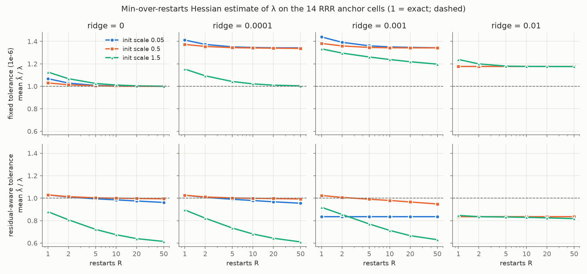

# arc/: reading the learning coefficient from arc spaces

The learning coefficient λ (the real log canonical threshold, RLCT) of a singular model
can be computed from **contact loci**: sets of arcs t ↦ w(t) along which the loss vanishes
to a given order (Mustață; Ein–Lazarsfeld–Mustață). The Hessian sees only first-order
contact. This folder uses the full arc picture for two things: to compute λ exactly on
models where it is known, and to explain a gap the rest of the repo measured, where
Hessian rank, DDS and VPD all undercount λ on reduced-rank regression.

Run everything with the repo's Python environment (numpy, scipy, jax with x64; torch for
the repo-level modules). The chronological notebook with all intermediate results is
[`NOTEBOOK.md`](NOTEBOOK.md); section numbers below (4f, ...) refer to it.

## Results

Status labels: **proved** (argument complete up to cited standard facts), **verified**
(exact or numerical agreement with known values), **partial** / **open**.

### 1. Reduced-rank regression: λ by counting arcs (proved; verified) — 4f

Model y = W₂W₁x with W₁ ∈ ℝ^{H×M}, W₂ ∈ ℝ^{N×H}, teacher of rank r0, loss
K = ‖W₂W₁ − M\*‖². Near the minimum-norm solution, r0(N+M−r0) coordinates split off as
regular; this is exactly the Hessian rank there. The rest is the ideal of entries of B′A′
in the reduced dimensions M′, N′, H′ (each minus r0).

Classify arcs B′(t) by Smith normal form over ℂ[[t]]. Each class has a known codimension
(Docampo), and requiring B′A′ to vanish to order p forces rows of A′ to vanish to
complementary orders. The total is linear in the Smith exponents, so the minimum sits at
exponents 0 or p. With k = the number of exponents at p:

    2λ = r0(N+M−r0) + min_{k = 0..min(N′,H′)} [ k² − k(M′ − |N′−H′|) + M′·min(N′,H′) ].

- Reproduces the full Aoyagi–Watanabe (2005) theorem on 2754 cells, including its
  odd/even case split. Here that split is just minimizing a quadratic over integers k.
- The codimension of every Smith class is confirmed by Jacobian rank of the jet scheme.
- Smith form works the same over ℝ[[t]] and the minimizing arcs are real, so this is the
  real RLCT. ([`rrr_orbit.py`](rrr_orbit.py))

### 2. What the Hessian misses on RRR: tangent excess, not higher-order contact (verified) — 4f, 4g

The bracket above does not depend on p: the minimum is reached at p = 1. So λ is half
the **codimension of the largest component of the true set** Z = {W₂W₁ = M\*}. Z has
several components, labelled by the excess ranks (α, β) of (W₁, W₂). They all meet at
the minimum-norm point. There

    2λ − rank ∇²K(w) = dim T_w Z − dim_w Z,

the excess of the tangent space over the true set's dimension. On the repo's 14-cell
anchor grid this is (H − r0)(N − r0).

- The repo's DDS and VPD studies (`../param_decomp_compare/rrr/`) read the model at the
  exactly constructed minimum-norm point, which is why they, like the Hessian rank there,
  give r0(N+M−r0) independent of H. Ridge-regularized training drifts to that point too,
  but only once the excess directions have decayed (§7).
- At a generic point of the largest component, rank ∇²K = 2λ. Taking the minimum Hessian
  rank over unregularized GD restarts (polished onto Z) recovers 2λ on 14/14 cells at
  three init scales. Perturb-and-project from the minimum-norm point also gives 14/14.
- Caveat: most restarts land on smaller components. In one cell the largest was reached
  in only 1-3 of 20 runs, and with one seed not at all, so min-over-restarts needs enough
  restarts. ([`step0_tangent_excess.py`](step0_tangent_excess.py))

### 3. Deep linear networks (depth 3 proved; depth ≥ 4 open) — 4h′, 4h″

For A_L ⋯ A_1 = 0, Pepin Lehalleur & Rimányi (PLR, arXiv:2411.19920) compute the
codimension C of the zero fiber and its number of top components θ (a quadratic integer
program and a Poincaré series). Their rlct = C/2 is obtained by comparison with Aoyagi's
formula (Neural Networks 2024), not proved directly.

- **Depth 2:** the arc count above equals PLR's integer program, in C and θ, on all 343
  dimension vectors tested.
- **Depth 3, new proof.** A₃ and A₁ share no vertex, so both can be put in Smith form;
  the middle matrix stays generic and contact becomes an entrywise condition. The cost is
  convex piecewise-linear, and as a linear program its constraint matrix (bipartite
  incidence plus identity) is totally unimodular. So the minimum is integral, attained at
  p = 1, and rlct = C/2 at depth 3 without using Aoyagi. Assumed rather than reproved:
  Docampo's codimension formula (checked numerically), the reduction from teacher rank r0
  to 0 for the lct, and the standard inequality RLCT_ℝ ≥ lct_ℂ. Verified against PLR's
  integer program and series on all 625 dimension vectors in [1,5]⁴.
  ([`deep_linear_orbit.py`](deep_linear_orbit.py))
- **Aoyagi's formula** (as restated in arXiv:2501.12747) equals the regular part plus
  PLR's C/2 on about 6,800 cases through depth 5. Her θ (the order of the pole, i.e. the
  power of log log n) and PLR's θ (number of top components) agree through depth 3 and
  first differ at depth 4, e.g. 5 vs 6 at (2,2,2,2,2). These are different invariants.
  ([`aoyagi_compare.py`](aoyagi_compare.py))
- **Pole order from arcs:** with the complete depth-3 stratification, the number of
  minimizing strata grows like p^(θ−1), matching Aoyagi's θ.
- **Depth ≥ 4 is open.** After the outer Smith forms, the middle pair has to satisfy a
  relative-position condition on submodules, which has no evident finite classification.
  Monomial (lace-with-exponent) strata, which generalize PLR's lace diagrams to arcs,
  attain C at every p tested. But they miss minimizers already at depth 3, so they cannot
  settle the depth-4 pole order. ([`deep_laces.py`](deep_laces.py))

### 4. Real vs complex (verified) — 4h, 4i

Lin (arXiv:1003.5338) proves λ = RLCT_ℝ(𝔞)/2 for the fiber ideal 𝔞 = (f₁, …, f_r) when
K ≍ Σ fᵢ². The complex threshold, which the arc-space theorems compute, can be strictly
smaller:

- K = (x² + y² + z²)² with 𝔞 = (x² + y² + z²): lct_ℂ/2 = 1/2, but λ = 3/4 (Monte Carlo:
  0.753). The minimizing complex divisor is the cone, whose only real point is 0.
- **Symmetric factorization** WWᵀ = M\*, the shape that appears in TMS's WᵀW.
  λ = (r0·n − r0(r0−1)/2)/2 + (n−r0)(k−r0)/4, which agrees with Monte Carlo on 6 cells.
  Here the real true set is smooth, and the gap over the Hessian is genuine quartic
  contact (where DDS's 1/4-per-direction count is right). Complex isotropic components
  with no real points push the complex threshold strictly below λ in 3 of the 6 cells.
  The /4 count itself matches Drton et al.'s factor-analysis results (arXiv:2511.15419).
- Counting **real** arcs gives the right answer in both cases.
  ([`real_vs_complex.py`](real_vs_complex.py))

So 2λ can exceed the Hessian rank by two distinct mechanisms: tangent excess at crossing
points (RRR), and higher-order transversal contact (symmetric factorization).

### 5. TMS calibrates; there is no gap (verified) — 4j

At the 5-, 5⁺- and 6-gon critical points of the Toy Model of Superposition (c = 6), the
exact Hessian has rank 14, 17, 17, i.e. λ = rank/2 = 7, 8.5, 8.5, matching Chen et al.
These points are Morse–Bott. The 4-gon sits on ReLU kinks, where the Hessian is not
meaningful.

### 6. A numerical contact-locus estimator (partial) — 4k

[`contact_gn.py`](contact_gn.py) finds points of real contact loci by proximal
Gauss–Newton on jet coefficients (`jax.experimental.jet`) and measures their dimension
by local PCA. It is correct on 10 of 15 validation cases: the smooth cases, x⁴, the
real-vs-complex example, two symmetric cells, and four RRR cells. It underestimates λ on
(ab)², a² + b⁶, the cusp (a² − b³)² and one symmetric cell. Deciding the real dimension of
a non-reduced jet scheme near a singular point at finite precision needs
numerical-algebraic-geometry tools (real witness sets, homotopy continuation). It is a
validation tool, not an estimator for real networks.

### 7. The min-over-restarts Hessian estimator in practice (verified) — 4l

§2 says the minimum Hessian rank over restarts recovers 2λ on RRR if runs reach generic
points of the true set. [`hessian_restarts.py`](hessian_restarts.py) tests this the way
a practitioner would run it. That means full-batch GD on K + ridge·‖w‖² for a fixed
20k steps, with no polishing onto the true set. Then the exact Hessian of K at the final
point, and λ̂ = min rank/2 over R restarts, bootstrapped from 50 runs per setting.
The grid is the 14 anchor cells × ridge ∈ {0, 1e-4, 1e-3, 1e-2} × init scale
∈ {0.05, 0.5, 1.5} × R ∈ {1, …, 50}.

*Mean λ̂/λ over the 14 cells (1 = exact). Top row: the repo's fixed relative tolerance
(1e-6). Bottom row: a residual-aware tolerance that ignores eigenvalues below 4‖R‖_F,
where R = W₂W₁ − M\*. In the ridge = 0.01 panels the init-0.05 and init-0.5 lines
coincide.*

- **Without weight decay, on converged runs, it works.** A single read overestimates λ
  by 3-7%, because most runs land on smaller components (larger codimension). Errors
  are one-sided upward, so the minimum over restarts converges. It is exact in 95-98%
  of cells at R = 10 and 98-100% at R = 20.
- **Weight decay breaks the fixed-tolerance read upward.** λ̂/λ is 1.18-1.34 even at
  R = 50. The exception is ridge 1e-4 from init 1.5, where runs have not converged and
  the ridge has barely acted. Runs never reach the true set. The residual R ≠ 0 adds a
  curvature term 2⟨R, dW₂dW₁⟩ to the Hessian of K, whose ± eigenvalues of size ~‖R‖ clear
  the tolerance and get counted as rank.
- **Thresholding out the residual exposes the minimum-norm undercount.** With a
  residual-aware tolerance, ridge 1e-4 at init 0.5 recovers λ (exact in 96% of cells at
  R = 10). But once ridge has had time to remove the excess directions (ridge = 1e-2, or
  ridge = 1e-3 from small init), every run sits at the minimum-norm point. There
  rank = r0(N+M−r0) and λ̂/λ ≈ 0.84, correct only in the 4 cells with no excess capacity.
  This is the regime of the repo's DDS and VPD studies.
- **Unconverged runs make the minimum unsafe.** From init scale 1.5 the loss is still
  ~2·10⁻⁴ after 20k steps. A residual-aware threshold then also removes genuine small
  curvature, so 35-44% of single reads fall *below* 2λ. Taking the minimum over more
  restarts selects those, and accuracy falls as R grows (λ̂/λ → 0.61). The fixed
  tolerance happens to survive here because it errs upward.

**Practical reading.** The estimator needs: no weight decay, or enough of it to land
cleanly at a known point; runs trained until the residual is far below the smallest
genuine curvature; and a rank threshold between the two. Min-over-restarts is only
safe when per-run errors are one-sided upward, so a check for that, such as the spread
of ranks across runs, belongs in any use of it. Caveats: population-loss full-batch GD,
not SGD on finite data; a fixed step budget; a linear model.

## Files

| file | contents | runtime |
|---|---|---|
| [`rrr_orbit.py`](rrr_orbit.py) | §1: orbit count vs Aoyagi–Watanabe; Jacobian check of every stratum | seconds |
| [`step0_tangent_excess.py`](step0_tangent_excess.py) | §2: components of Z, Hessian rank by GD restarts and by perturb-and-project | ~6 min |
| [`deep_linear_orbit.py`](deep_linear_orbit.py) | §3: PLR's integer program and series vs our count, depths 2-3; depth-3 strata check | ~15 s |
| [`aoyagi_compare.py`](aoyagi_compare.py) | §3: Aoyagi's deep-linear formula vs PLR through depth 5 | ~1 s |
| [`deep_laces.py`](deep_laces.py) | §3: monomial strata, depths 2-5; `python deep_laces.py 3 L3` counts complete depth-3 minimizing strata | ~10 s |
| [`real_vs_complex.py`](real_vs_complex.py) | §4: counterexamples, symmetric λ by Monte Carlo | ~20 s |
| [`hessian_restarts.py`](hessian_restarts.py) | §7: min-over-restarts Hessian estimator vs restarts, ridge, init scale; writes `results/hessian_restarts.json` | ~40 min |
| [`plot_hessian_restarts.py`](plot_hessian_restarts.py) | §7 figure from the saved results | seconds |
| [`contact_gn.py`](contact_gn.py) | §6: numerical real contact loci | ~45 min |
| [`early/`](early/) | first experiments: linear-arc orders, the failed tube-volume design, `jet` convention test, jet lifting demo (notebook 4a-4e) | |
| [`NOTEBOOK.md`](NOTEBOOK.md) | chronological working notes, references | |

Related: [`../notes/dds_arc.pdf`](../notes/dds_arc.pdf), a short note on how Dead-Direction
Signatures relate to contact loci and where they diverge.
